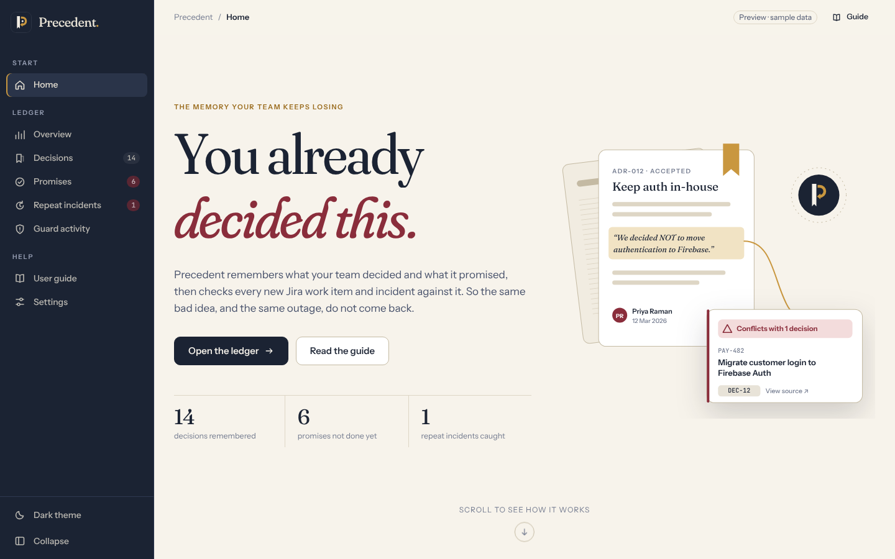
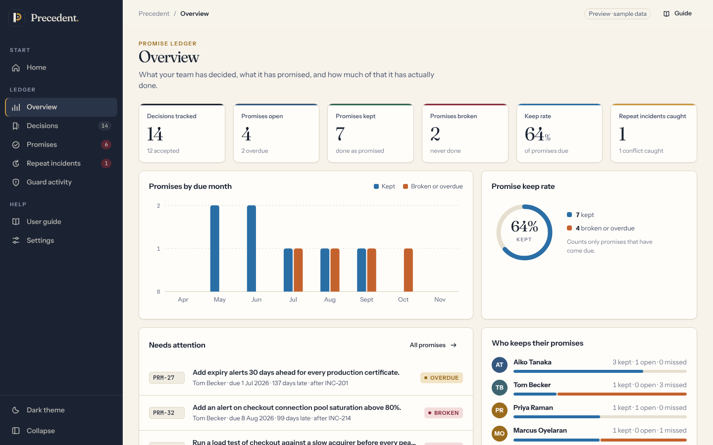
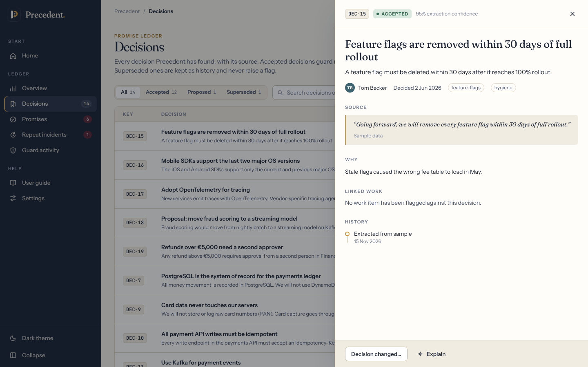
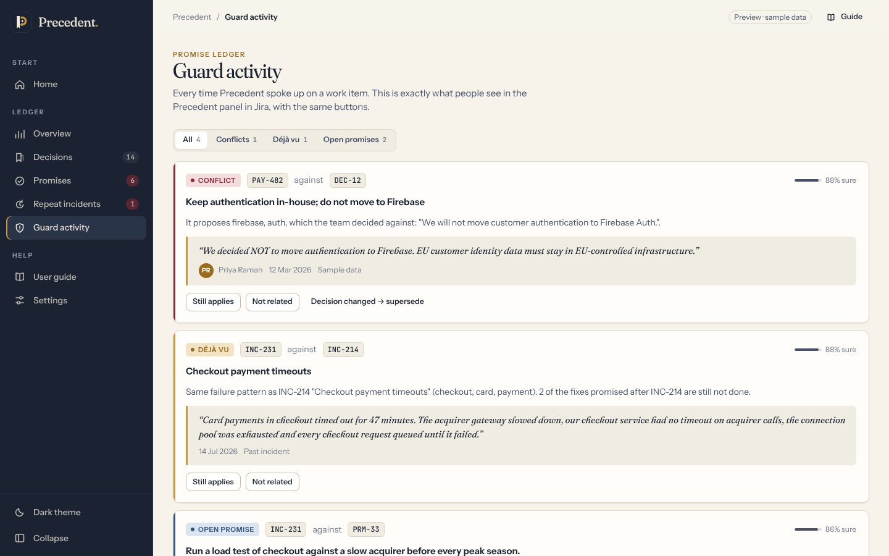
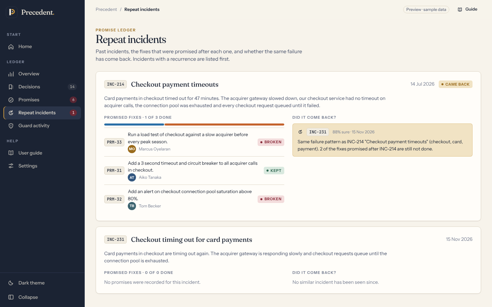
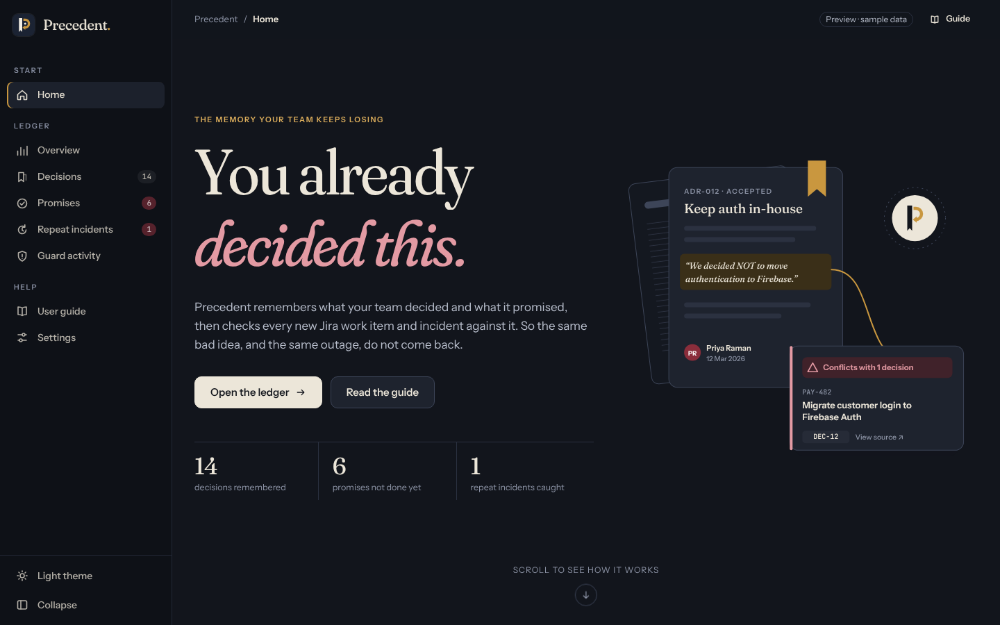

<p align="center"></p>
<h1 align="center">Precedent</h1>
<p align="center"><b>Your team already decided this.</b><br>Precedent remembers what your team decided and promised, and guards new Jira work against it.</p>



Built on Atlassian Forge for Codegeist 2026 (Apps for Software Teams, Best Agents bonus).

## The problem

Teams forget what they decided and what they promised. Decisions sit in Confluence pages. Postmortem action items never get done. Months later the same bad idea, or the same outage, comes back.

## What Precedent does

| | |
|---|---|
| **Extracts** | Reads Confluence pages, post-incident reviews and Jira comments and lifts out decisions and promises, each with the exact source quote, owner and date. Anything without a real quote is dropped. |
| **Guards** | When a work item or incident is created or edited, it is checked against the ledger in the background. The Jira panel shows **Conflict**, **Déjà vu** or **Open promise**, always with source link, quote, who and when. |
| **Tracks** | Promises live in a ledger with owner, due date and a live status (open, kept, broken, overdue) synced daily from the linked Jira work item, plus a promise keep rate. |
| **Keeps history** | Decisions move proposed → accepted → superseded. A superseded decision is never overwritten; it points to its successor and stops raising flags. |

Other tools find similar incidents, or let you keep a manual decision register. Precedent extracts both decisions **and** promises automatically and actively guards new work against them, with cited sources.

## Screens

| Overview | Decision detail |
|---|---|
|  |  |
| **Guard activity** | **Repeat incidents** |
|  |  |

Dark mode follows Jira's theme: 

## Architecture

```
Confluence page / Jira comment ──trigger──▶ extraction queue ──▶ extraction worker ─┐
                                                                (Forge LLM, small)  │
Jira work item created/edited ──trigger──▶ guard queue ──▶ guard worker             ▼
   (debounced 60 s)                         1 cheap candidate retrieval      Forge SQL ledger
                                            2 LLM judge per candidate        decisions · promises
                                            3 incident déjà vu               incidents · flags
daily scheduled trigger ──▶ promise sync ──────────────────────────────────▶ feedback · links
                                                                                    ▲
Issue panel (UI Kit) · Ledger + Settings (Custom UI) · Confluence byline ── read ───┘
Rovo agent "Precedent" + 5 actions, also exposed through rovo:mcp
```

- **The UI never waits on an LLM.** Screens read the ledger only; all AI work runs in queue consumers.
- **Never invents.** Every extracted item must quote the source verbatim; the quote is checked against the text before it is stored.
- **Cheap first.** Candidates are retrieved with keywords, scope tags and graph neighbours; only the top 15 reach the LLM judge. Results are cached by content hash.
- **Always works.** If Forge LLMs or the Teamwork Graph are unavailable, rule-based fallbacks take over.
- **Respects permissions.** UI reads check access as the user; quotes from pages you cannot open are withheld.

| Path | What is there |
|---|---|
| `manifest.yml` | 28 modules: issue panel, global page, admin page, byline, triggers, consumers, SQL, LLM, Rovo agent, actions, MCP |
| `src/ledger` | Pure domain logic: schema, repository, candidate retrieval, rules, read models |
| `src/ai` | Prompts, zod schemas, strict-JSON client, extraction, judge, explanations, eval runner |
| `src/workers` | Extraction, guard, promise sync and sample-data loader |
| `src/resolvers`, `src/rovo`, `src/graph`, `src/platform` | UI API, Rovo actions, Teamwork Graph with REST fallback, Forge adapters |
| `src/frontend` | UI Kit issue panel and Confluence byline |
| `static/` | Custom UI (Vite + React + TypeScript): home, ledger, guide, settings |
| `tests/` | 57 unit tests and 46 labelled eval cases |

## Run it

```bash
npm install
npm run ui:install
npm run check        # typecheck, unit tests, manifest validation
npm run eval         # offline accuracy of the conflict judge
npm run build        # builds the Custom UI into static/*/build
npm run ui:dev       # local preview with sample data at http://127.0.0.1:5173
```

Deploy to your own site (needs the Forge CLI and an Atlassian developer site):

```bash
forge register          # writes your app id into manifest.yml
npm run build
forge deploy
forge install --upgrade # pick Jira, then run again for Confluence
```

Then open **Apps → Precedent → Settings** and press **Load sample data**. See [TESTING.md](TESTING.md) for the full walkthrough.

## Accuracy

Offline, rule-based judge on 46 labelled cases: **precision 1.00, recall 0.80**. Details and how to measure the LLM judge on your site are in [docs/EVAL.md](docs/EVAL.md).

## More

[User testing guide](TESTING.md) · [Eval](docs/EVAL.md) · [Platform spike notes](docs/SPIKE.md) · [Agent skill](docs/skill.md) · [Connect an AI client over MCP](docs/MCP.md) · [Video script](docs/VIDEO_SCRIPT.md) · [Devpost text](docs/DEVPOST.md)

Built by Vineeta. MIT licence.
